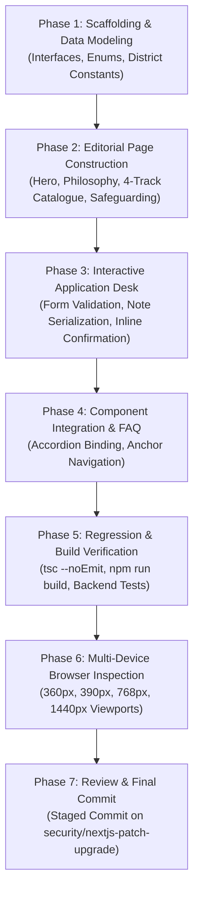

# MAHAVIR TRUST — Volunteer Section: Implementation Roadmap

**Document Reference**: `VOLUNTEER_IMPLEMENTATION_ROADMAP.md`  
**Classification**: Engineering Execution & Phasing Plan  
**Author**: Principal Software Architect & Senior Engineering Lead  
**Date**: November 2, 2026  
**Status**: DRAFT IMPLEMENTATION ROADMAP (Awaiting Approval)  

---

## 1. Execution Philosophy & Pre-Conditions

In accordance with institutional project guidelines:
1. **Zero Premature Code Modifications**: No source code, package installations, or database migrations will be executed until the project owner provides formal approval.
2. **Preservation of Core Contracts**: The existing backend endpoint (`POST /api/v1/public/volunteers`) and database schema (`volunteer_registrations`) are preserved without regression.
3. **Isolated Worktree Execution**: All implementation will occur strictly within `.worktrees/security-patch` on branch `security/nextjs-patch-upgrade`. The root repository on `main` remains pristine.

---

## 2. Phased Implementation Sequence

---

### Phase 1: Architectural Scaffolding & Constants Preparation
- **Objective**: Establish shared data structures and constants without modifying backend dependencies.
- **Tasks**:
  - Define Odisha 30-district lookup array in TypeScript (Khordha, Cuttack, Mayurbhanj, Koraput, Sundargarh, Balasore, Ganjam, etc., plus "Outside Odisha / NRI").
  - Define the 4 volunteer role types matching backend `roleInterest` constraints (`VARCHAR(50)`):
    1. `"Academic & Entrance Exam Mentor"`
    2. `"Career & Professional Guide"`
    3. `"Project Samarth Hub Steward"`
    4. `"College & Faculty Liaison"`
  - Define availability options (`"1-2 hrs/month"`, `"2-4 hrs/month"`, `"Weekly Hub Support"`).
- **Estimated Effort**: 0.5 Engineering Hours  
- **Complexity**: Low  

---

### Phase 2: Editorial Page Construction & Visual Sections
- **Objective**: Build the visual, non-form editorial sections of `/volunteer` adhering to the Phase 2 institutional design system.
- **Tasks**:
  - Author the Hero Banner with institutional breadcrumbs and key metrics strip.
  - Implement Section 2: Foundational Philosophy & Purpose of Mentorship.
  - Implement Section 3: Four Pillars (Why Volunteer with MAHAVIR TRUST).
  - Implement Section 4: Comprehensive 4-Role Catalogue Matrix with visual tags, time commitments, and anchor jump links.
  - Implement Section 5: The 4-Stage Vetting, Induction & Matching Pathway (Horizontal on desktop, vertical on mobile).
  - Implement Section 6: Safeguarding, Child Protection & Ethical Governance Notice.
  - Implement Section 7: Priority District Hub Footprint.
- **Estimated Effort**: 2.5 Engineering Hours  
- **Complexity**: Medium  

---

### Phase 3: Interactive Application Desk & Form Handling
- **Objective**: Construct the accessible, high-integrity registration form and confirmation experience.
- **Tasks**:
  - Implement state machine: `idle` -> `submitting` -> `success` / `error`.
  - Implement responsive form grid (Name, Email, Phone, District dropdown, Role selector, Qualification, Availability, Background Notes, Mandatory Declaration Checkbox).
  - Implement input sanitization and client-side validation rules.
  - Package extended metadata into `backgroundNotes` string to guarantee 100% backward compatibility with `POST /api/v1/public/volunteers`.
  - Author the Inline Confirmation Card: Displays reference ID `#REF-XXXX`, 5-day review SLA, and reset trigger.
- **Estimated Effort**: 2.0 Engineering Hours  
- **Complexity**: Medium  

---

### Phase 4: Reusable Component Integration & FAQ
- **Objective**: Connect existing verified components and finish supporting sections.
- **Tasks**:
  - Embed `@/components/Accordion` with 6 detailed volunteer & mentorship questions.
  - Implement Secretariat Inquiry Contact Box for institutional/faculty partnerships.
  - Implement quick-anchor links (`#apply`) so clicking *"Apply for this Role"* on any role card automatically scrolls to the form and pre-selects the chosen track.
- **Estimated Effort**: 1.0 Engineering Hours  
- **Complexity**: Low  

---

### Phase 5: Build, Typecheck & Regression Verification
- **Objective**: Validate complete system integrity with zero errors.
- **Tasks**:
  - Run `npx tsc --noEmit` to verify strict TypeScript compliance.
  - Run `npm run build` to confirm static page generation and bundle sizes.
  - Run backend regression suite: `mvn test` (or Gradle test suite).
  - Verify homepage (`src/app/page.tsx`) volunteer section functions without regression.
- **Estimated Effort**: 1.0 Engineering Hours  
- **Complexity**: Low  

---

### Phase 6: Autonomous Visual Inspection & Cross-Device Testing
- **Objective**: Inspect visual quality, typography, spacing, and interaction states.
- **Tasks**:
  - Start local Next.js server.
  - Launch autonomous browser agent to test viewports:
    - Desktop: `1440 × 900`
    - Tablet: `768 × 1024`
    - Mobile: `390 × 844` and `360 × 740`
  - Perform live form submission and capture screenshots of:
    - Initial page top / hero
    - Role catalogue matrix
    - Safeguarding callout
    - Form filling and validation
    - Success confirmation card with reference ID
    - Accordion expand/collapse
- **Estimated Effort**: 1.5 Engineering Hours  
- **Complexity**: Medium  

---

### Phase 7: Final Documentation & Git Commit
- **Objective**: Commit verified changes with clean documentation.
- **Tasks**:
  - Generate implementation report: `VOLUNTEER_IMPLEMENTATION_REPORT.md`.
  - Stage only relevant files: `src/app/volunteer/page.tsx`, `VOLUNTEER_IMPLEMENTATION_REPORT.md`.
  - Commit to branch `security/nextjs-patch-upgrade`.
  - Ensure main working directory remains clean.
- **Estimated Effort**: 0.5 Engineering Hours  
- **Complexity**: Low  

---

## 3. Total Estimated Effort & Complexity Summary

- **Total Estimated Hours**: **9.0 Engineering Hours**
- **Overall Complexity**: **Medium** (High UX quality, straightforward backend contract reuse)
- **Primary Technical Risk**: Accidental schema misalignment with backend `roleInterest` `VARCHAR(50)` limit.  
  *Mitigation*: Keep role strings within 40 characters (e.g., `"Academic & Entrance Exam Mentor"` is 31 chars; well under the 50-char ceiling).
