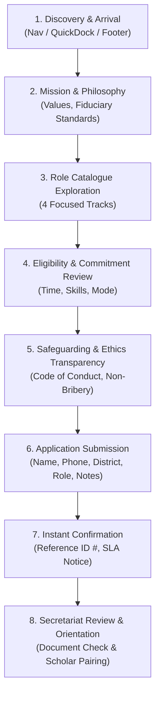

# MAHAVIR TRUST — Volunteer Section: Requirements Specification

**Document Reference**: `VOLUNTEER_REQUIREMENTS_SPECIFICATION.md`  
**Classification**: Product Requirements Document (PRD)  
**Author**: Principal Software Architect & Senior Product Designer  
**Date**: November 2, 2026  
**Status**: DRAFT SPECIFICATION (Awaiting Project Owner Approval)  

---

## 1. Purpose & Strategic Mission

The MAHAVIR TRUST Volunteer & Mentorship initiative connects committed academicians, working professionals, retired educators, and community leaders with first-generation undergraduate and diploma scholars across Odisha. 

While financial grants (tuition fees paid directly to colleges) remove the immediate economic barrier to higher education, empirical evidence shows that rural and underprivileged students face severe secondary hurdles: lack of career orientation, absence of professional networks, entrance examination anxieties, and limited study facilities. 

The Volunteer section on `mahavirtrust.org/volunteer` serves as the **institutional front door for volunteer recruitment, screening, induction, and ethical stewardship**.

---

## 2. Target Volunteer Personas & Programmatic Alignment

Every proposed volunteer profile must directly support one of the Trust's three approved programmatic initiatives:
1. *Shiksha Protsahan Yojana* (Undergraduate Merit-cum-Means Grants)
2. *Pratibha Fellowship* (Girls in STEM & Professional Courses)
3. *Project Samarth Community Study Hubs* (District Learning Centers)

### Persona Evaluation Matrix

| Volunteer Role / Persona | Target Demographics | Primary Program Alignment | Responsibilities | Expected Time Commitment | Alignment Status |
| :--- | :--- | :--- | :--- | :--- | :--- |
| **1. Academic & Entrance Exam Mentor** | College professors, lecturers, post-graduate scholars, subject teachers | *Shiksha Protsahan* & *Pratibha Fellowship* | Monthly academic reviews, entrance test strategy (GATE, OPSC, IIT-JAM, NET), clearing subject bottlenecks in science, commerce, and engineering. | **2 to 4 hours per month** (Virtual / Hybrid) | **APPROVED & ESSENTIAL** |
| **2. Career & Professional Guide** | Working corporate professionals, engineers, healthcare practitioners, civil servants | *Pratibha Fellowship* & Final-year Scholars | Resume guidance, mock interviews, industry insight, workplace readiness, overcoming first-generation professional anxiety. | **2 hours per month** (Virtual) | **APPROVED & ESSENTIAL** |
| **3. Project Samarth Study Hub Steward** | Local resident educators, youth leaders, retired government officers | *Project Samarth Community Study Hubs* | Physical stewardship of rural study centers, maintaining book registry, proctoring digital terminals, ensuring quiet study environment. | **4 to 8 hours per week** (In-Person at District Hub) | **APPROVED & ESSENTIAL** |
| **4. College & Institutional Faculty Liaison** | Serving faculty members, heads of department, and registrars in Odisha colleges | Grant Scrutiny & Direct Disbursal Verification | Facilitating bona fide certificate validation, identifying deserving students prior to dropout, fee structure cross-verification. | **1 to 2 hours per semester** (Institutional) | **APPROVED & ESSENTIAL** |
| *5. Unsupervised Child Care Worker* | General public | None | General child care | Variable | **REJECTED**: Outside the Trust's higher education scope; presents avoidable safeguarding risks. |
| *6. Door-to-Door Cash Collectors* | General public | None | Cash handling | Variable | **REJECTED**: Violates the Trust's strict 100% non-cash, zero-intermediary statutory policy. |

---

## 3. End-to-End Visitor Journey

The volunteer user experience is structured into an 8-stage journey:



### Stage Details:
1. **Discovery**: Prospective volunteers enter via navigation link *"Get Involved"*, homepage participation CTA, or QuickActionDock pill.
2. **Institutional Mission**: The visitor is greeted with the Trust's founding ethos: Dignity in learning, ethical stewardship, and focused empowerment across Odisha's 30 districts.
3. **Role Catalogue**: Clear comparative cards presenting the 4 approved roles with distinct badges (Academic, Career, Community Hub, College Liaison).
4. **Prerequisites & Commitments**: Explicit clarification of required qualifications, minimum commitment (e.g. 2 hours/month), and engagement mode (Virtual vs In-Person).
5. **Safeguarding & Governance**: Clear disclaimer that all volunteers undergo identity verification and must abide by the Trust's Student Protection and Anti-Bribery Code of Conduct.
6. **Application Form**: Streamlined, accessible form with fields: Full Name, Email, Phone, District (Odisha's 30 districts dropdown), Preferred Role, Highest Qualification, Availability, and Motivation/Background notes.
7. **Confirmation Experience**: Inline replacement with official confirmation card containing unique Reference ID, expectations of contact, and secretariat contact information.
8. **Orientation Pathway**: Clear roadmap explaining the 4-step onboarding timeline from application to active mentoring.

---

## 4. Functional Requirements

### 4.1 Form Fields & Input Schema

| Field Name | Type | Requirement | Validation Rules | Rationale |
| :--- | :--- | :--- | :--- | :--- |
| `fullName` | String | **Mandatory** | 3–150 chars, alphabetic + honorifics | Official identification for correspondence |
| `email` | String (Email) | **Mandatory** | Valid RFC-compliant email, max 255 chars | Primary channel for orientation invites & documentation |
| `phone` | String (Tel) | **Mandatory** | 10-digit Indian mobile format (`+91` or 10 digits) | Fast communication, SMS orientation alerts |
| `district` | Dropdown | **Mandatory** | One of Odisha's 30 official districts or "Outside Odisha / NRI" | Geographic matching for study hubs and college liaison |
| `roleInterest` | Dropdown | **Mandatory** | One of 4 approved tracks (max 50 chars) | Core role routing for volunteer coordinators |
| `highestQualification`| Dropdown / Text | **Optional** | Post-Graduate, Doctorate, Graduate, Professional (CA/Law/Eng) | Ensures appropriate pairing (e.g. M.Sc mentor for B.Sc scholar) |
| `availabilityHours`| Dropdown | **Mandatory** | "1-2 hrs/month", "3-5 hrs/month", "Weekly Hub Support" | Prevents volunteer drop-out due to unrealistic expectations |
| `backgroundNotes` | Textarea | **Optional** | Max 2000 characters | Narrative describing subject expertise and prior mentoring |
| `declarationConsent`| Checkbox | **Mandatory** | Must be checked (`true`) | Formal acknowledgement of safeguarding & volunteer terms |

### 4.2 Data Normalization & Packaging
- In order to **strictly maintain backward compatibility** with the existing backend API (`POST /api/v1/public/volunteers`) which accepts `{ fullName, email, phone, roleInterest, backgroundNotes }`, the extended form attributes (`district`, `highestQualification`, `availabilityHours`, `consent`) will be **structured and serialized into `backgroundNotes`**:
  ```text
  [District: Mayurbhanj | Qualification: M.Sc Mathematics | Availability: 2-4 hrs/month | Consent: Agreed]
  Additional Notes: I have 8 years of teaching experience in higher secondary mathematics...
  ```
- This ensures zero breaking changes to the database or Java backend while capturing all necessary institutional metadata immediately!

---

## 5. Non-Functional Requirements

- **Performance**: Initial page load under 1.5 seconds on 4G networks; bundle size under 220 kB.
- **Accessibility**: 100% compliance with WCAG 2.2 Level AA (proper `aria-*` attributes, contrast ratio `≥ 4.5:1`, keyboard traversable, visible focus rings).
- **Responsive Layout**: Seamless presentation across 360px, 390px, 768px, 1024px, 1440px, and 1920px viewports without horizontal scrolling or text overlap.
- **Security & Privacy**: Protection against spam/flooding via client debouncing and backend token-bucket rate limiting (30 req/min); no storage of sensitive identity documents during initial application.

---

## 6. Classification of Information

- **Verified Facts**: The backend endpoint `/public/volunteers` currently accepts 5 JSON fields and returns a numerical reference ID. The database contains `volunteer_registrations`.
- **Existing Implementation**: 285-line basic form on `/volunteer` with 3 brief cards.
- **Proposed Improvements**: 8-section institutional portal, 4 approved role tracks, 4-step vetting timeline, 30-district selector, safeguarding declaration, and FAQ accordion.
- **Unverified Institutional Information**: The exact dates of future physical orientation sessions and specific mentor training modules will be scheduled by the Secretariat Desk upon trustee confirmation.
- **Open Questions**:
  1. *Will remote mentors receive a digital ID badge or certificate of appreciation?* (Proposed: Yes, digital certificate after 1 academic cycle).
  2. *Should institutional faculty liaisons be required to provide an official college email address?* (Proposed: Encouraged, but personal email permitted for initial inquiry).
