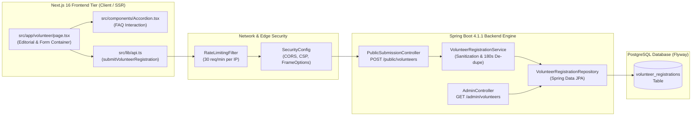

# MAHAVIR TRUST — Volunteer Section: Technical Architecture Specification

**Document Reference**: `VOLUNTEER_TECHNICAL_ARCHITECTURE.md`  
**Classification**: Backend, Frontend & Database Systems Architecture  
**Author**: Principal Software Architect & Senior Java Spring Boot Engineer  
**Date**: November 2, 2026  
**Status**: DRAFT ARCHITECTURE BLUEPRINT (Zero-Code Modification Phase)  

---

## 1. Architectural Overview & System Boundaries

The MAHAVIR TRUST platform operates as a decoupled, modern architecture:
- **Client Presentation Tier**: Next.js 16 (App Router), React 19, TypeScript, Tailwind CSS v4, Motion.
- **Application & API Tier**: Java 21, Spring Boot 4.1.1, Spring Security, Spring Data JPA, Jakarta Bean Validation.
- **Persistence Tier**: PostgreSQL 16 managed via Flyway database migrations.
- **Security & Infrastructure**: Stateless JWT Authentication, Token-Bucket IP Rate Limiting, HTTP-only security headers, CORS restrictions.



---

## 2. API Contract Specification

### 2.1 Public Volunteer Registration Endpoint

- **URI**: `/api/v1/public/volunteers`
- **HTTP Method**: `POST`
- **Content-Type**: `application/json`
- **Security Level**: Public (`permitAll()` in `SecurityConfig.java`)
- **Rate Limit**: Maximum 30 requests/minute per client IP (enforced by `RateLimitingFilter.java`)
- **Idempotency / De-duplication**: 180-second window on identical `email` + `roleInterest` (enforced by `VolunteerRegistrationService.java`).

#### Request Payload Schema (`CreateVolunteerRequest`)

```json
{
  "fullName": "Prof. Sandeep Mohanty",
  "email": "sandeep.mohanty@example.edu.in",
  "phone": "+919876543210",
  "roleInterest": "Academic & Entrance Exam Mentor",
  "backgroundNotes": "[District: Mayurbhanj | Qualification: Ph.D. Physics | Availability: 2-4 hrs/month | Mode: Virtual | Consent: Declared] 12 years of experience preparing rural students for national entrance exams."
}
```

#### Field Constraints & Validation Matrix

| Field | JSON Type | Validation Constraints | Failure HTTP Code | Error Message |
| :--- | :--- | :--- | :--- | :--- |
| `fullName` | String | `@NotBlank`, `@Size(max = 150)` | 400 Bad Request | `"Full name is required"` / `"Full name must not exceed 150 characters"` |
| `email` | String | `@NotBlank`, `@Email`, `@Size(max = 255)` | 400 Bad Request | `"Email is required"` / `"Email must be a valid email address"` |
| `phone` | String | `@NotBlank`, `@Size(max = 30)` | 400 Bad Request | `"Phone number is required"` / `"Phone must not exceed 30 characters"` |
| `roleInterest` | String | `@NotBlank`, `@Size(max = 50)` | 400 Bad Request | `"Role of interest is required"` / `"Role interest must not exceed 50 characters"` |
| `backgroundNotes`| String | `@Size(max = 2000)` (Optional) | 400 Bad Request | `"Background notes must not exceed 2000 characters"` |

#### Success Response (`SubmissionResponse`)
- **HTTP Status**: `201 Created`
- **Body**:
```json
{
  "status": "SUCCESS",
  "referenceId": 42,
  "message": "Your volunteer registration has been logged for orientation review.",
  "timestamp": "2026-11-02T12:45:00.000Z"
}
```

#### Duplicate Submission Response (Within 180 Seconds)
- **HTTP Status**: `201 Created` (Idempotent success)
- **Body**:
```json
{
  "status": "SUCCESS",
  "referenceId": 42,
  "message": "Your volunteer registration is already recorded under reference #42.",
  "timestamp": "2026-11-02T12:45:00.000Z"
}
```

#### Error Responses
- **Validation Failure (`400 Bad Request`)**:
```json
{
  "status": 400,
  "error": "Validation Failed",
  "validationErrors": [
    "Email must be a valid email address",
    "Role of interest is required"
  ],
  "path": "/api/v1/public/volunteers",
  "timestamp": "2026-11-02T12:45:01.000Z"
}
```
- **Rate Limit Exceeded (`429 Too Many Requests`)**:
```json
{
  "status": 429,
  "error": "Too Many Requests",
  "message": "Submission rate limit exceeded. Please wait a minute before submitting again.",
  "path": "/api/v1/public/volunteers",
  "timestamp": "2026-11-02T12:45:02.000Z"
}
```

---

## 3. Database Schema Evaluation & Evolution Strategy

### 3.1 Current Table Schema (`V1__initial_schema.sql`)
```sql
CREATE TABLE IF NOT EXISTS volunteer_registrations (
    id BIGSERIAL PRIMARY KEY,
    full_name VARCHAR(150) NOT NULL,
    email VARCHAR(255) NOT NULL,
    phone VARCHAR(30) NOT NULL,
    role_interest VARCHAR(50) NOT NULL,
    background_notes TEXT,
    verification_status VARCHAR(30) NOT NULL DEFAULT 'AWAITING_ORIENTATION',
    created_at TIMESTAMP WITH TIME ZONE NOT NULL DEFAULT CURRENT_TIMESTAMP
);
```

### 3.2 Architectural Tradeoff Analysis: Strategy A vs Strategy B

| Dimension | Strategy A: Structured Note Serialization (Recommended for Current Phase) | Strategy B: Database Schema Migration (`V3__volunteer_fields.sql`) |
| :--- | :--- | :--- |
| **Database Changes** | **Zero**. Reuses existing `volunteer_registrations` schema. | Requires new Flyway migration `V3__volunteer_fields.sql`. |
| **Backend Code Changes** | **Zero**. Reuses existing `CreateVolunteerRequest` and `VolunteerRegistrationService`. | Requires modifying `VolunteerRegistration.java`, DTO, Repository, and Tests. |
| **Frontend Compatibility** | **100% Backward Compatible**. Frontend serializes metadata tags into `backgroundNotes`. | Requires updating `CreateVolunteerPayload` in `src/lib/api.ts`. |
| **Production Risk** | **Zero Risk**. Cannot break any existing migrations or backend contracts. | Low-to-Medium risk of migration collision or schema desynchronization. |
| **Searchability** | Notes are searchable via SQL `LIKE` or PostgreSQL `ILIKE`. | Clean column-level querying (`WHERE district = 'Mayurbhanj'`). |
| **Recommendation** | **Adopt for Phase 2.3 frontend rollout**. | **Schedule for Phase 3 (Administrative Portal & CRM)**. |

#### Strategy A Metadata Format Specification:
When the user submits the redesigned form on `/volunteer`, the frontend packages the inputs as follows:
```typescript
const formattedNotes = [
  `[District: ${formData.district}]`,
  formData.qualification ? `[Qualification: ${formData.qualification}]` : null,
  `[Availability: ${formData.availability}]`,
  `[Mode: ${formData.engagementMode}]`,
  formData.notes ? `Notes: ${formData.notes}` : null
].filter(Boolean).join(" ");
```

---

## 4. Administrative Oversight Architecture (For Secretariat Review)

### 4.1 Existing Read Endpoint
- **URI**: `GET /api/v1/admin/volunteers`
- **Role Permission**: `@PreAuthorize("hasAnyRole('SUPER_ADMIN', 'ADMIN', 'VOLUNTEER_COORDINATOR')")`
- **Implementation in `AdminController.java`**:
  ```java
  @GetMapping("/volunteers")
  @PreAuthorize("hasAnyRole('SUPER_ADMIN', 'ADMIN', 'VOLUNTEER_COORDINATOR')")
  public ResponseEntity<List<VolunteerRegistration>> getAllVolunteers() {
      return ResponseEntity.ok(volunteerRepository.findAll());
  }
  ```

### 4.2 Proposed Administrative Mutation Endpoint (Phase 3 Evolution)
To support volunteer lifecycle management, the following endpoint is planned for the administrative portal:
- **URI**: `PATCH /api/v1/admin/volunteers/{id}/status`
- **Request Body**: `{"status": "VERIFIED" | "ORIENTATION_COMPLETED" | "ACTIVE_MENTOR" | "INACTIVE"}`
- **Audit Logging**: Recorded in `audit_logs` table via `AdminUserService.logAction()`.

---

## 5. Security & Input Sanitization Architecture

1. **XSS Sanitization**:
   `VolunteerRegistrationService.sanitizeInput()` uses standard regex stripping:
   ```java
   private String sanitizeInput(String input) {
       if (input == null) return null;
       return input.replaceAll("(?i)<script.*?>.*?</script>", "")
                   .replaceAll("<[^>]*>", "");
   }
   ```
2. **SQL Injection**:
   100% mitigated through Spring Data JPA parameterized queries and prepared statements.
3. **Spam & Flooding Protection**:
   - Client-side: Button disablement during active submission (`isSubmitting = true`).
   - Server-side: `RateLimitingFilter` (30 requests/minute per IP).
   - Database: 180-second duplicate submission window on `email + roleInterest`.

---

## 6. Technical Dependencies & Component Reusability

- **`Header.tsx`**: Provides sticky header, announcement ticker, and active navigation.
- **`Footer.tsx`**: Provides complete institutional sitemap and legal statutory disclosures.
- **`Accordion.tsx`**: Reusable for the 6-question Volunteer FAQ section.
- **`Card.tsx` / `Button.tsx`**: Base UI elements in `src/components/ui/`.
- **`motion/react`**: Provides lightweight staggered entrances without external dependencies.
- **`lucide-react`**: Icons (`Users`, `GraduationCap`, `Building2`, `Clock`, `ShieldCheck`, `CheckCircle2`, `Send`, `Loader2`).
